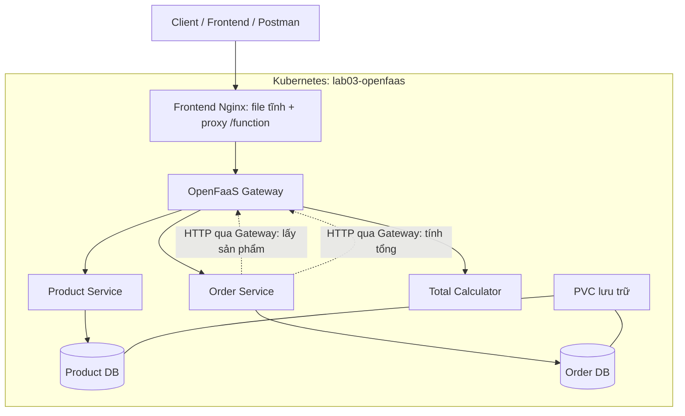

# BÁO CÁO LAB 03 — MICROSERVICES VỚI OPENFAAS

- Sinh viên: ........................................
- MSSV: .............................................
- Lớp: ..............................................
- Ngày hoàn tất kiểm thử: 23/10/2026.

Bản Word có ảnh minh chứng thực tế được lưu cục bộ tại `reports/Bao_cao_Lab03_OpenFaaS.docx`.

## 1. Mục tiêu

Tìm hiểu OpenFaaS, tự xây dựng dịch vụ bằng Python, đóng gói thành container và thực hành triển khai lên Kubernetes. Ví dụ nghiệp vụ là một cửa hàng văn phòng phẩm nhỏ, gồm ba dịch vụ độc lập.

## 2. Cơ sở lý thuyết

### 2.1. Microservices

Ứng dụng được phân tách thành những dịch vụ có trách nhiệm riêng, có thể triển khai riêng và giao tiếp qua API. Trong bài lab, Product quản lý danh mục; Order xử lý đơn; Calculator thực hiện tính toán.

Tách dữ liệu theo dịch vụ giúp tránh để một service sửa trực tiếp dữ liệu nội bộ của service khác.

### 2.2. OpenFaaS và FaaS

OpenFaaS là nền tảng triển khai function và HTTP microservice từ container image. Người phát triển cung cấp logic xử lý, template hỗ trợ HTTP runner và watchdog, Gateway cung cấp điểm gọi dịch vụ.

Serverless không có nghĩa là không tồn tại máy chủ. Hạ tầng vẫn cần chạy; nền tảng hỗ trợ người phát triển đóng gói và vận hành workload.

### 2.3. Docker, Kubernetes và Minikube

Docker tạo image và chạy container. Kubernetes điều phối container, kiểm tra trạng thái và quản lý tài nguyên. Minikube tạo cụm Kubernetes trên máy local để học tập. K3s là một lựa chọn phân phối Kubernetes khác; bài này sử dụng Minikube.

## 3. Kiến trúc

Hai database nằm trong cùng một PostgreSQL instance cho gọn tài nguyên, nhưng có chủ sở hữu và quyền kết nối riêng. PostgreSQL chạy ngoài các function, trong namespace lab03-data.

Nginx frontend phục vụ HTML/CSS/JavaScript và proxy đường dẫn function để tránh cấu hình CORS giữa frontend/API trong demo. Không dùng Kong vì OpenFaaS Gateway đã đủ cho phạm vi bài lab.

## 4. Công nghệ và cấu trúc mã

| Thành phần | Công nghệ |
|---|---|
| Nghiệp vụ | Python 3.12 trong container |
| Function template | python3-http-debian chính thức |
| Local HTTP adapter | Flask + Waitress |
| Database driver | psycopg 3 |
| Giao tiếp service | HTTP, requests, timeout rõ ràng |
| Database | PostgreSQL 17 |
| Giao diện | HTML/CSS/JavaScript |
| Cụm Kubernetes | Minikube, Kubernetes 1.35.0 |
| Nền tảng FaaS | OpenFaaS CE, Helm chart 15.0.14 |

Các file services/product_service.py, order_service.py và total_calculator.py chứa logic dùng chung giữa bản local và OpenFaaS. Script prepare_functions.py tạo handler theo giao diện handle(event, context) của template.

## 5. Thiết kế dữ liệu

### Product DB

Bảng products: id UUID; name; description; category; price_vnd BIGINT; active; created_at; updated_at.

Ngừng bán bằng active=false, không xóa bản ghi. Giá tiền dùng số nguyên VND để tránh sai số dấu phẩy động.

### Order DB

Bảng orders: id UUID; customer_name; phone; address; note; status; items JSONB; total_vnd BIGINT; idempotency_key UNIQUE; request_hash; created_at; updated_at.

Items lưu bản chụp product_id, product_name, unit_price_vnd, quantity và line_total_vnd. Không có foreign key sang Product DB.

## 6. Luồng tạo đơn

1. Client gửi thông tin nhận hàng, mã sản phẩm và số lượng.
2. Order kiểm tra JSON, UUID, độ dài và số lượng; gộp các dòng trùng mã sản phẩm.
3. Order kiểm tra Idempotency-Key đã tồn tại hay chưa.
4. Order lấy giá và trạng thái bán từ Product qua Gateway.
5. Order gửi danh sách giá/số lượng sang Calculator.
6. Order kiểm tra kết quả và ghi đơn cùng snapshot vào Order DB bằng một giao dịch.
7. Client nhận HTTP 201; gửi lại cùng yêu cầu nhận đơn cũ với HTTP 200.

Nếu Product/Calculator gặp lỗi hoặc timeout, không ghi đơn dở dang. Hệ thống chưa thực hiện giao dịch phân tán hoặc giữ chỗ tồn kho.

## 7. Đóng gói và triển khai

### Local

Compose chạy PostgreSQL, ba service, một adapter định tuyến Nginx và frontend. Compose giúp kiểm thử logic nghiệp vụ trước khi đưa lên OpenFaaS, không được xem là kết quả triển khai OpenFaaS.

### OpenFaaS

Tạo namespace hệ thống và function; cài chart CE; tạo PostgreSQL StatefulSet/PVC và các secret; build từng function theo template; publish image public; deploy qua Gateway; xác minh pod và API.

Secret database được gắn thành file trong function. Image không chứa mật khẩu hay dữ liệu đơn hàng.

### Vấn đề đã gặp

- faas-cli Windows hiểu đường dẫn ổ D: như URL scheme. Xử lý bằng CLI Linux chính thức trong Docker để tạo build context.
- Cổng 8080 đã do IIS sử dụng. Chọn localhost:18080 cho Gateway.
- OpenFaaS CE trong môi trường này từ chối image registry nội bộ và yêu cầu image public. Đã đẩy ba image lên Docker Hub public, tag 1.0.0, tài khoản giabaonguyentran; kiểm tra manifest không đăng nhập thành công.
- Font tiếng Việt được đóng gói cục bộ. ConfigMap assets dùng server-side apply để tránh giới hạn annotation.

## 8. Kết quả kiểm thử thực tế

| Nhóm | Số kiểm tra | Kết quả |
|---|---:|---|
| Unit test | 15 | Đạt |
| API với PostgreSQL thật | 25 | Đạt |
| Lỗi/phục hồi và cách ly database | 7 | Đạt |
| Giao diện | Đặt hàng, tạo sản phẩm ngừng bán | Đạt |
| API qua OpenFaaS Gateway | 25 | Đạt |
| Function trên OpenFaaS | 3 | Running và Ready |
| Docker Hub tải public | 3 | Đạt |

Các kiểm tra đáng chú ý: hai request đồng thời chỉ tạo một đơn; giá do client sửa không được dùng; đổi giá sản phẩm không đổi đơn cũ; đơn còn nguyên sau khi PostgreSQL khởi động lại; tài khoản Product không kết nối được Order DB và ngược lại.

Minh chứng: `evidence/local-api.json`, `evidence/local-resilience.json`, `evidence/openfaas-api.json`, `evidence/report-status.json` và `evidence/dockerhub-public.json`. Tám ảnh frontend Kubernetes được giữ cục bộ trong `evidence/report-shots/` và đưa vào bản Word, không upload lên repository.

## 9. Giới hạn và hướng phát triển

Bản demo chưa có đăng nhập, phân quyền, tồn kho, thanh toán thật, phân trang và giao dịch phân tán. Danh sách đơn dùng chung cho phiên demo; chưa phù hợp để đưa trực tiếp ra Internet.

Mở rộng có thể gồm xác thực, quyền quản trị, thanh toán sandbox, quản lý tồn kho có kiểm soát đồng thời, migration database, quan sát hệ thống và registry lưu image lâu dài.

## 10. Kết luận

Đã xây dựng, đóng gói và triển khai thành công ba service Python trên OpenFaaS CE trong Kubernetes. Ba function đều Ready; API qua Gateway đạt 25/25. Frontend thực hiện được luồng mua hàng, xem và hủy đơn, quản lý sản phẩm. PVC PostgreSQL Bound 1 GiB; dữ liệu và secret được tách khỏi image function.

## Tài liệu tham khảo

1. [OpenFaaS](https://www.openfaas.com/)
2. [Cài OpenFaaS CE trên Kubernetes](https://docs.openfaas.com/deployment/kubernetes/)
3. [Python templates](https://docs.openfaas.com/languages/python/)
4. [HTTP microservices và workloads](https://docs.openfaas.com/reference/workloads/)
5. [Secrets](https://docs.openfaas.com/reference/secrets/)
6. [CLI và sử dụng CLI container](https://docs.openfaas.com/cli/install/)
